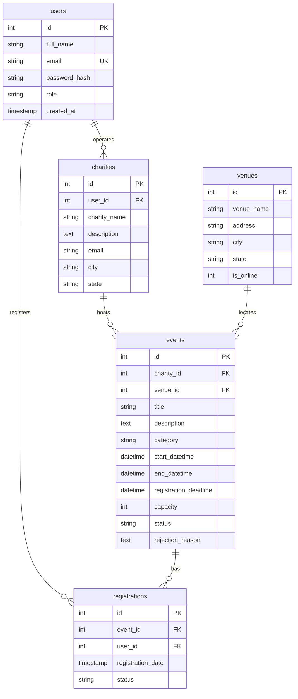

# Charity Event Calendar — Full-Stack Web Application on AWS

> **Academic Cloud Computing Project**  
> A high-availability, multi-tiered online charity event, fundraising, and volunteer coordination platform deployed using **Amazon EC2 Auto Scaling, Application Load Balancer (ALB), Amazon RDS for MySQL, AWS Secrets Manager, and IAM Roles**.

---

## Table of Contents
1. [Project Overview & Objectives](#1-project-overview--objectives)
2. [User Roles & Functional Workflows](#2-user-roles--functional-workflows)
3. [Technology Stack](#3-technology-stack)
4. [Cloud Architecture & Request Flow](#4-cloud-architecture--request-flow)
5. [Database Design & Entity-Relationship Diagram](#5-database-design--entity-relationship-diagram)
6. [Local Development & Setup Guide](#6-local-development--setup-guide)
7. [Step-by-Step AWS Cloud Deployment Guide](#7-step-by-step-aws-cloud-deployment-guide)
8. [Automated Testing & Verification](#8-automated-testing--verification)
9. [Troubleshooting Common Cloud Issues](#9-troubleshooting-common-cloud-issues)
10. [Resource Cleanup & Cost Management](#10-resource-cleanup--cost-management)
11. [5-Minute College Demonstration Script](#11-5-minute-college-demonstration-script)
12. [Viva Voce Questions & Answers](#12-viva-voce-questions--answers)

---

## 1. Project Overview & Objectives

In non-profit communities, local charities often struggle with centralized event publicity, while citizens face friction discovering legitimate donation drives and volunteer campaigns.

**Charity Event Calendar** provides a unified, secure platform where:
- Verified non-profits publish upcoming community programs.
- Citizens easily search, filter, and register for events with real-time capacity management.
- Administrators review and approve submissions, filtering out non-compliant or fraudulent listings.
- The underlying infrastructure demonstrates enterprise-level AWS architectural principles: **High Availability across Availability Zones (AZs)**, **Auto Scaling self-healing**, **Multi-Tier Security Groups**, and **Zero-Secret Codebases via AWS Secrets Manager**.

---

## 2. User Roles & Functional Workflows

The application implements three distinct roles with strict server-side Role-Based Access Control (RBAC):

### A. Public Visitor (No Account Required)
- Browse approved charity causes by date, category, and city.
- Search by keywords or non-profit name.
- View detailed itineraries, venues (physical or virtual streams), and capacity counters.
- Create an account to RSVP and reserve event spots.

### B. Charity Organizer (Authenticated)
- Register as an organizer and complete an organization profile.
- Submit new events (automatically assigned `pending` status).
- Edit and cancel existing organization events.
- Enforced isolation: Organizers cannot modify or access other organizations' events.
- View real-time attendee rosters and RSVP counts.

### C. System Administrator (Authenticated)
- Access administrative command center and platform analytics.
- Review pending submissions in a dedicated approval queue.
- Approve events to publish them to the live public catalog.
- Reject events with mandatory documented feedback explaining requirements (e.g., permits, liability insurance).
- Manage charities, modify user privileges, and remove inappropriate content.

---

## 3. Technology Stack

| Layer | Technologies | Justification |
| :--- | :--- | :--- |
| **Frontend** | HTML5, CSS3, Bootstrap 5.3, Bootstrap Icons, JavaScript | Lightweight, fully responsive across mobile, tablet, and desktop with zero heavy build steps. |
| **Backend** | PHP 8.x, PDO (PHP Data Objects) | Robust server-side scripting with prepared statement SQL injection defense and secure session handling. |
| **Database** | MySQL 8.0 on Amazon RDS | Relational ACID transactions, foreign key constraints, indexes, and row-level locking for concurrent RSVP safety. |
| **Compute** | Amazon EC2 in Auto Scaling Group (ASG) | Horizontal elasticity with automated instance launch and termination based on traffic and health probes. |
| **Load Balancing** | AWS Application Load Balancer (ALB) | Layer 7 HTTP/HTTPS traffic routing across multiple AZs with continuous health monitoring via `/health.php`. |
| **Security & Secrets** | AWS Secrets Manager & IAM Roles | Credentials retrieved dynamically over IMDSv2 and cached with 15-minute TTL. No hardcoded database credentials. |

---

## 4. Cloud Architecture & Request Flow

```
Internet (Users / Organizers / Admins)
      │
      ▼
Application Load Balancer (ALB) [Public Subnets: us-east-1a, us-east-1b]
      │
      ├──> Periodic Health Check (/health.php)
      │
      ▼
Auto Scaling Group (ASG) [Application Subnets: 2 AZs]
  ├── EC2 Instance (AZ-a): Apache + PHP 8
  └── EC2 Instance (AZ-b): Apache + PHP 8
      │
      ├── Assumes IAM Role (CharityAppEc2Role) via IMDSv2
      ├── Requests DB Credentials from AWS Secrets Manager (SigV4)
      │
      ▼ (Port 3306 - Private)
Amazon RDS MySQL 8.0 [Database Subnet Group across 2 AZs]
```

### Request Flow Explained
1. Traffic reaches the ALB DNS name over HTTP (Port 80).
2. The ALB checks target instance health by querying `/health.php` every 15 seconds. If healthy (`HTTP 200`), it distributes traffic.
3. The running EC2 instances securely fetch temporary AWS credentials via EC2 Instance Metadata Service (IMDSv2) to query AWS Secrets Manager.
4. Database credentials (`host`, `username`, `password`, `dbname`, `port`) are retrieved, cached locally for 15 minutes, and used by PDO to connect to private Amazon RDS.

---

## 5. Database Design & Entity-Relationship Diagram



### Relationships Explained
- **`users` to `charities` (1:N)**: A user with role `organizer` creates and manages a charity organization profile.
- **`charities` to `events` (1:N)**: A charity can publish multiple events. Deleting a charity cascades to its events.
- **`venues` to `events` (1:N)**: Physical venues or virtual stream locations can host multiple events over time.
- **`events` to `registrations` (1:N)**: Attendees register for events. Enforces `UNIQUE(event_id, user_id)` to prevent duplicate registrations.

---

## 6. Local Development & Setup Guide

### Prerequisites
- PHP 8.0+ (with `pdo`, `pdo_mysql`, `curl`, `json`, `mbstring`, `openssl`)
- MySQL 8.0 or MariaDB (via XAMPP, WampServer, or native MySQL)

### Step 1: Clone Repository
```bash
git clone https://github.com/your-username/charity-event-calendar.git
cd charity-event-calendar
```

### Step 2: Configure Environment
Copy `.env.example` to `.env`:
```bash
cp .env.example .env
```
Adjust the parameters for your local MySQL server:
```ini
APP_ENV=development
APP_DEBUG=true
DB_HOST=127.0.0.1
DB_PORT=3306
DB_NAME=charity_calendar
DB_USER=root
DB_PASS=
USE_AWS_SECRETS=false
```

### Step 3: Initialize Database & Seed Sample Records
Using MySQL command line:
```bash
mysql -u root -p < database/schema.sql
mysql -u root -p charity_calendar < database/seed.sql
```
*(Or import `database/schema.sql` and `database/seed.sql` inside phpMyAdmin)*.

### Step 4: Launch Built-In PHP Development Server
```bash
php -S localhost:8000
```
Open your browser to: **`http://localhost:8000`**

### Pre-Seeded Demonstration Accounts
| Role | Email Address | Password |
| :--- | :--- | :--- |
| **Administrator** | `admin@charitycalendar.org` | `Password@123` |
| **Organizer (Hope Foundation)** | `sarah@hopefoundation.org` | `Password@123` |
| **Organizer (Food For All)** | `marcus@foodforall.org` | `Password@123` |
| **Community Visitor** | `john.doe@example.com` | `Password@123` |

---

## 7. Step-by-Step AWS Cloud Deployment Guide

Follow this guide to deploy onto standard AWS or **AWS Academy Learner Lab**.

### Phase 1: Database Tier (Amazon RDS MySQL)
1. Open the **Amazon RDS** console in region `us-east-1`.
2. Click **Subnet Groups** -> **Create DB Subnet Group**:
   - Name: `charity-db-subnet-group`
   - VPC: Select Default VPC.
   - Availability Zones: Select at least two (e.g. `us-east-1a`, `us-east-1b`).
3. Click **Databases** -> **Create Database**:
   - Engine: **MySQL** (version 8.0.x)
   - Template: **Free Tier** (or Dev/Test)
   - DB Instance Identifier: `charity-calendar-rds`
   - Master Username: `charityadmin`
   - Master Password: `YourSecurePassword123!`
   - Instance Class: `db.t3.micro` or `db.t4g.micro`
   - Public Access: **No**
   - VPC Security Group: Create New -> `charity-rds-sg`
   - Initial Database Name (under Additional Configuration): `charity_calendar`
4. Click **Create Database**. Once status is **Available**, note the **Endpoint address**.

### Phase 2: Credentials Security (AWS Secrets Manager)
1. Open **AWS Secrets Manager** console.
2. Click **Store a new secret** -> Choose **Other type of secret**.
3. Add the following Key/Value pairs:
   - `host`: `<your-rds-endpoint>`
   - `port`: `3306`
   - `dbname`: `charity_calendar`
   - `username`: `charityadmin`
   - `password`: `YourSecurePassword123!`
4. Secret Name: `charity-calendar/rds-credentials`
5. Click Next and **Store Secret**.

### Phase 3: IAM Role & Security Groups
1. **EC2 IAM Role**:
   - In AWS Academy: Use the pre-existing **`LabRole`** (it already has permissions for EC2 and Secrets Manager).
   - In standard AWS: Create role for EC2 with policy `secretsmanager:GetSecretValue` on the secret ARN.
2. **Security Groups**:
   - `charity-alb-sg`: Inbound Port 80 from `0.0.0.0/0`.
   - `charity-ec2-sg`: Inbound Port 80 with Source = `charity-alb-sg`.
   - Update `charity-rds-sg`: Inbound Port 3306 with Source = `charity-ec2-sg`.

### Phase 4: Application Load Balancer (ALB)
1. Open **EC2 Console** -> **Target Groups** -> **Create target group**:
   - Target Type: **Instances**
   - Target group name: `charity-tg`
   - Protocol: HTTP (Port 80)
   - Health Check Path: `/health.php`
   - Advanced Health Check settings: Healthy Threshold = `2`, Interval = `15` seconds.
2. Open **Load Balancers** -> **Create Application Load Balancer**:
   - Name: `charity-alb`
   - Scheme: Internet-facing
   - Subnets: Choose 2 public subnets in different AZs.
   - Security Group: `charity-alb-sg`
   - Listener: Forward Port 80 to `charity-tg`.

### Phase 5: Launch Template & Auto Scaling Group
1. Open **Launch Templates** -> **Create launch template**:
   - Name: `charity-launch-template`
   - AMI: Amazon Linux 2023 AMI
   - Instance Type: `t3.micro`
   - IAM Instance Profile: Select `LabRole` (or `CharityAppEc2Role`).
   - Security Group: `charity-ec2-sg`
   - User Data (under Advanced Details): Paste the contents of `scripts/install.sh`.
2. Open **Auto Scaling Groups** -> **Create Auto Scaling Group**:
   - Name: `charity-asg`
   - Launch Template: `charity-launch-template`
   - Subnets: Select 2 subnets across AZs.
   - Load Balancing: Attach to existing target group -> `charity-tg`.
   - Group Size: Min = `1`, Desired = `2`, Max = `3`.
   - Health Check Type: Check **ELB** health checks.

### Phase 6: Import Database Schema & Seed Data
Connect to an EC2 instance using **EC2 Instance Connect** or **Session Manager**:
```bash
mysql -h <rds-endpoint> -u charityadmin -p charity_calendar < /var/www/html/database/schema.sql
mysql -h <rds-endpoint> -u charityadmin -p charity_calendar < /var/www/html/database/seed.sql
```

---

## 8. Automated Testing & Verification

The project includes an automated test suite verifying 35 functional and security checks:
```bash
php tests/run-tests.php
```

### Verified Test Cases:
- [x] PHP 8.0+ runtime & PDO MySQL extensions
- [x] Cross-Site Scripting (XSS) output escaping via `e()`
- [x] Cryptographic CSRF token generation and validation
- [x] Bcrypt password hashing (`PASSWORD_BCRYPT`)
- [x] Database schema creation with primary/foreign keys and indexes
- [x] Workflow 1: Public event filtering (approved events visible, pending hidden)
- [x] Workflow 2: Organizer event submission with default `pending` status
- [x] Workflow 3: Administrator review, approval, and rejection with documented reasons
- [x] Workflow 4: Concurrency-safe event RSVP & exact capacity enforcement
- [x] Duplicate registration prevention via unique constraints
- [x] Strict organizer resource ownership enforcement (cross-tenant editing blocked)
- [x] Rate limiting & brute-force protection (lockout after 5 failed attempts)
- [x] ALB health probe endpoint (`/health.php` returns HTTP 200/503)

---

## 9. Troubleshooting Common Cloud Issues

| Symptom | Root Cause | Resolution |
| :--- | :--- | :--- |
| **ALB returns HTTP 502 Bad Gateway** | Target group health check failing or Apache not running on EC2. | Open target group `charity-tg` in console to see health status. SSH to EC2 and run `curl http://localhost/health.php` and `systemctl status httpd`. |
| **HTTP 503 on `/health.php`** | Database unreachable from EC2. | Verify `charity-rds-sg` allows Port 3306 from `charity-ec2-sg`. Verify RDS endpoint in Secrets Manager. |
| **Database credentials error** | EC2 IAM role missing permissions for Secrets Manager. | Ensure EC2 has `LabRole` or `CharityAppEc2Role` attached. Test with `aws secretsmanager get-secret-value --secret-id charity-calendar/rds-credentials --region us-east-1`. |
| **Images not loading** | Outbound internet access restricted on private subnet. | The application includes automated category-based Unsplash fallbacks. In private subnets, configure a NAT Gateway or VPC Endpoints. |

---

## 10. Resource Cleanup & Cost Management

To prevent ongoing charges after your demonstration, delete resources in this order:
1. **Auto Scaling Group**: Set Min, Desired, Max to `0`, then delete `charity-asg`.
2. **Application Load Balancer**: Delete `charity-alb` and Target Group `charity-tg`.
3. **Amazon RDS Database**: Delete `charity-calendar-rds` (uncheck "create final snapshot").
4. **AWS Secrets Manager**: Delete secret `charity-calendar/rds-credentials` (schedule 7-day deletion).
5. **Security Groups**: Delete `charity-alb-sg`, `charity-ec2-sg`, `charity-rds-sg`.

---

## 11. 5-Minute College Demonstration Script

| Time | Demonstration Step | Key Talking Points |
| :--- | :--- | :--- |
| **0:00 - 0:45** | **Architecture Overview** | Show the AWS architecture diagram. Explain how the ALB routes traffic across two Availability Zones to EC2 instances in an Auto Scaling Group, retrieving RDS credentials via Secrets Manager. |
| **0:45 - 1:30** | **Live Homepage & Explore Events** | Access the live ALB DNS URL. Highlight the platform impact metrics, categories, upcoming approved events, and the `/health.php` ALB endpoint returning HTTP 200. |
| **1:30 - 2:45** | **Organizer Workflow (Workflow 2)** | Log in as Organizer (`sarah@hopefoundation.org`). Submit a new charity event "Youth Coding & Robotics Workshop". Show that the event status is immediately marked **Pending Review**. Open public catalog to prove it is **hidden** from public visitors. |
| **2:45 - 3:45** | **Administrator Approval (Workflow 3)** | Log out and sign in as Administrator (`admin@charitycalendar.org`). Open `/admin/pending-events.php`. Review the submission and click **Approve Event**. Refresh the public catalog to show the event is now live! |
| **3:45 - 4:30** | **Registration & Capacity (Workflow 4)** | Log in as a visitor (`john.doe@example.com`). Register for an event. Demonstrate that the attendee count increments, the progress bar updates, and duplicate registrations are blocked. |
| **4:30 - 5:00** | **High Availability & Security Conclusion** | Conclude by explaining how terminating one EC2 instance causes the ALB to seamlessly redirect traffic to the healthy instance in the other AZ with zero downtime. |

---

## 12. Viva Voce Questions & Answers

### Q1: Why did you place EC2 instances and Amazon RDS in private subnets?
**Answer:** Following the defense-in-depth security model, only the Application Load Balancer requires public internet access. The EC2 application instances and RDS database reside in private subnets, shielded from direct internet attacks. The RDS database only accepts inbound traffic on port 3306 from the EC2 security group.

### Q2: How does the application retrieve database credentials without hardcoding them?
**Answer:** The application uses AWS Secrets Manager. When the PHP application connects, it queries the EC2 Instance Metadata Service (IMDSv2) to assume its IAM Role (`secretsmanager:GetSecretValue`), retrieves the JSON credentials, and caches them for 15 minutes. No database passwords exist in source code or Git.

### Q3: What is the purpose of `/health.php`?
**Answer:** It acts as the Application Load Balancer health check probe. It executes a lightweight `SELECT 1` database query. If the instance and database are healthy, it returns HTTP 200. If the database connection drops, it returns HTTP 503 without leaking stack traces or credentials, signaling the ALB to route traffic away from that unhealthy instance.

### Q4: How do you handle race conditions when multiple users register for the last available spot simultaneously?
**Answer:** The registration workflow is wrapped in a database transaction with row-level locking (`SELECT capacity ... FOR UPDATE`). This serializes concurrent registration requests, accurately counts confirmed registrations under lock, and rolls back if capacity is exceeded, guaranteeing no overbooking.

### Q5: How does Auto Scaling provide self-healing?
**Answer:** The Auto Scaling Group maintains a minimum and desired instance count (e.g. 2 instances). If an instance experiences hardware failure or fails ALB health checks, the ASG automatically terminates the degraded instance and launches a fresh replacement from the Launch Template into a healthy Availability Zone.
